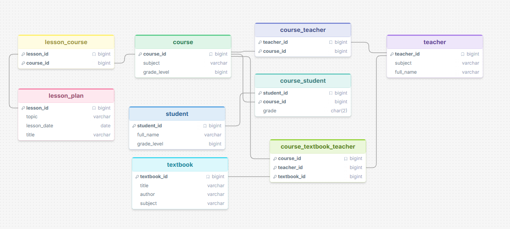

# Homeschool Co-op: Natural Language Database Q&A

Ask questions about a homeschool co-op in plain English and get answers in plain English. The app uses Claude to turn each question into SQL, runs that SQL on a SQLite database, then has Claude explain the results.

## The database

The co-op database tracks teachers (parents who teach), students, courses, textbooks and lesson plans.



| Table | What it holds |
|---|---|
| `teacher` | Each teacher's name and main subject |
| `student` | Each student's name and grade level |
| `course` | Courses offered (the course name is in `subject`) and their grade level |
| `textbook` | Title, author and subject of each textbook |
| `lesson_plan` | Individual lessons with a topic, title and date |
| `course_teacher` | Which teachers teach which courses (some courses are co-taught) |
| `course_student` | Which students are enrolled in which courses, with their letter grade |
| `course_textbook_teacher` | Which textbook a teacher uses in a course |
| `lesson_course` | Which courses each lesson plan belongs to (some lessons are shared) |

The sample data has 8 teachers, 20 students in grades 5–10, 10 courses, 11 textbooks, 27 lesson plans and 58 enrollments. The table definitions are in [schema.sql](schema.sql) and the data is in [data.sql](data.sql).

## How it works

1. You type a question.
2. The app sends Claude the question plus the database schema and asks for a single SQLite `SELECT` statement.
3. The app runs that SQL on `homeschool.db`. The database is opened read-only, so a bad query can't change any data. If the SQL fails, the app sends Claude the error and gives it one chance to fix the query.
4. The app sends Claude the question, the SQL and the rows it returned, and asks for a short plain-English answer.
5. The app prints the SQL and the answer.

## Running it

You need Python 3.10+ and an [Anthropic API key](https://platform.claude.com).

```bash
pip install -r requirements.txt
```

Put your key in a `secrets.json` file in the project folder. It's listed in `.gitignore`, so it never gets committed:

```json
{ "anthropic_api_key": "sk-ant-..." }
```

`homeschool.db` is already included. To rebuild it from the SQL files:

```bash
python setup_db.py
```

Start the app, then type questions. Type `quit` to exit.

```bash
python app.py                       # few-shot (default)
python app.py --strategy zero-shot  # zero-shot
```

## Prompting strategies

- **Zero-shot:** Claude gets only the schema and the question.
- **Few-shot (single-domain):** Claude also gets one worked example from this same database, the question "Which students are taking Biology, and what grades do they have?" with its SQL.

## Sample questions and answers

Each question below was run with both strategies, using `claude-opus-5-5`. Unless noted, both strategies gave the same correct answer. I checked each answer against the data by hand.

### Who teaches the most courses?

```sql
SELECT t.full_name, COUNT(*) AS course_count
FROM teacher t
JOIN course_teacher ct ON ct.teacher_id = t.teacher_id
GROUP BY t.teacher_id, t.full_name
HAVING COUNT(*) = (
    SELECT MAX(cnt) FROM (
        SELECT COUNT(*) AS cnt FROM course_teacher GROUP BY teacher_id
    )
)
ORDER BY t.full_name;
```

> David Nguyen teaches the most courses, with 3 in total.

Correct. He teaches Biology and Earth Science and co-teaches Physical Education. The `HAVING` clause means ties would also be shown.

### Which lessons are coming up?

```sql
SELECT lesson_id, title, topic, lesson_date
FROM lesson_plan
WHERE lesson_date >= date('now')
ORDER BY lesson_date, lesson_id;
```

> Two lessons are coming up: Solving Systems by Substitution (Systems of Equations) on October 27, 2026, and Reading a Weather Map (Weather) on October 30, 2026.

Correct for a run on October 24, 2026. The app tells Claude to use `date('now')`, so the answer stays correct as time passes.

### Which textbooks by Margaret Ellis are being used, and in which courses?

```sql
SELECT DISTINCT t.title, c.subject AS course, c.grade_level
FROM textbook t
JOIN course_textbook_teacher ctt ON ctt.textbook_id = t.textbook_id
JOIN course c ON c.course_id = ctt.course_id
WHERE t.author = 'Margaret Ellis'
ORDER BY t.title, c.subject, c.grade_level;
```

> Two of Margaret Ellis's textbooks are in use. Classic Voices: An English Literature Anthology is used in 10th-grade English Literature, and Writing Strong Essays is used in both 10th-grade American History and 10th-grade English Literature.

Correct. This one needs a three-table join through `course_textbook_teacher`.

### What is the average grade in Biology?

The SQL is shortened slightly here; the generated query also counted the graded students.

```sql
SELECT ROUND(AVG(CASE TRIM(cs.grade)
        WHEN 'A+' THEN 4.0 WHEN 'A'  THEN 4.0 WHEN 'A-' THEN 3.7
        WHEN 'B+' THEN 3.3 WHEN 'B'  THEN 3.0 WHEN 'B-' THEN 2.7
        WHEN 'C+' THEN 2.3 WHEN 'C'  THEN 2.0 WHEN 'C-' THEN 1.7
        WHEN 'D+' THEN 1.3 WHEN 'D'  THEN 1.0 WHEN 'D-' THEN 0.7
        WHEN 'F'  THEN 0.0
    END), 2) AS average_grade_points
FROM course_student cs
JOIN course c ON c.course_id = cs.course_id
WHERE c.subject = 'Biology';
```

> The average grade in Biology is about 3.34 on a 4.0 scale, roughly a B+, based on 5 graded students.

Correct: (3.7 + 3.3 + 2.7 + 4.0 + 3.0) / 5 = 3.34. Grades are stored as letters, so Claude converted them to grade points on its own without being told to.

### What's Emma Wilson's schedule? (the strategies differ)

This was the only question where the two strategies gave meaningfully different answers.

**Zero-shot** read "schedule" as "upcoming lessons" and filtered on `lesson_date >= date('now')`:

> Emma Wilson's next scheduled lesson is in Algebra I (grade 9) with Sarah Thompson on October 27, 2026: "Solving Systems by Substitution," part of the Systems of Equations unit. This only covers upcoming lessons, so any other classes she's in without future lessons planned wouldn't appear here.

This misses that Emma is also taking Biology and Spanish I. Claude at least warned that the answer might be incomplete.

**Few-shot** joined through her enrollments and returned every course and lesson:

> Emma Wilson is taking Algebra I with Sarah Thompson, Biology with David Nguyen, and Spanish I with Maria Garcia, with lessons running from September 8 to October 27, 2026. She starts on September 8 with "Solving One-Step Equations" in Algebra and "Greetings and Introductions" in Spanish, followed by "Parts of the Cell" in Biology on September 10. Her last scheduled lesson is "Solving Systems by Substitution" in Algebra on October 27.

This is the better answer for someone asking what a student's schedule looks like.

## Zero-shot vs few-shot

| Question | Zero-shot | Few-shot |
|---|---|---|
| Who teaches the most courses? | Correct | Correct |
| Which lessons are coming up? | Correct | Correct |
| Margaret Ellis's textbooks | Correct | Correct |
| Average grade in Biology | Correct | Correct |
| Emma Wilson's schedule | Incomplete (upcoming lessons only) | Correct |

**What I found:**

- On a small, clearly named schema, zero-shot already does well. Four of the five questions came out essentially the same, often with nearly identical SQL.
- The difference showed up on a vague question. "Schedule" could mean upcoming lessons or every class a student takes. The few-shot example shows a query that starts from a student and joins through `course_student` to courses, and that pattern seems to have nudged Claude toward the enrollment-based reading.
- Writing the column hints into the prompt mattered as much as the example. Telling Claude that course names live in `course.subject` and that dates are `YYYY-MM-DD` text kept both strategies from guessing wrong.

## Files

| File | Purpose |
|---|---|
| `app.py` | The question-and-answer app |
| `setup_db.py` | Rebuilds `homeschool.db` from the SQL files |
| `schema.sql` | Table definitions |
| `data.sql` | Sample data |
| `homeschool.db` | The ready-built SQLite database |
| `schema.png` | Schema diagram |
